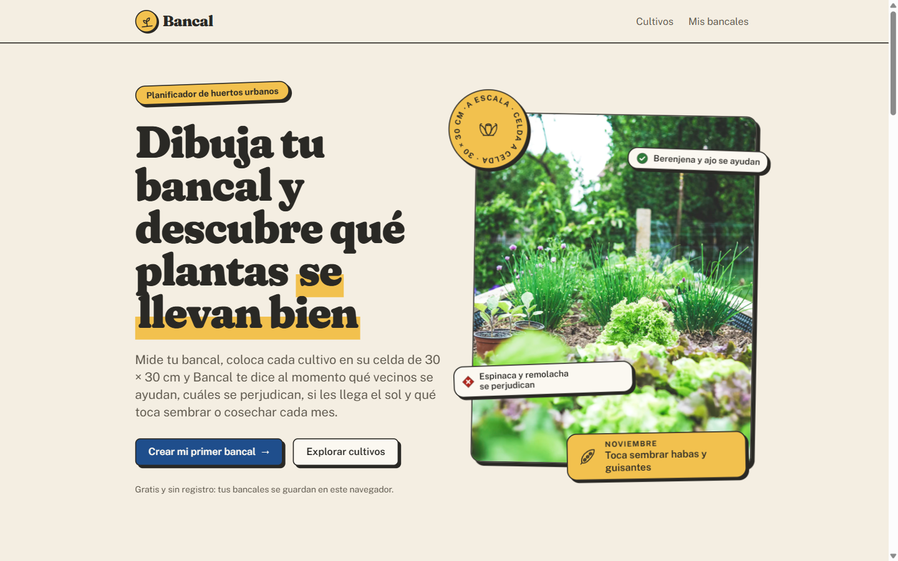
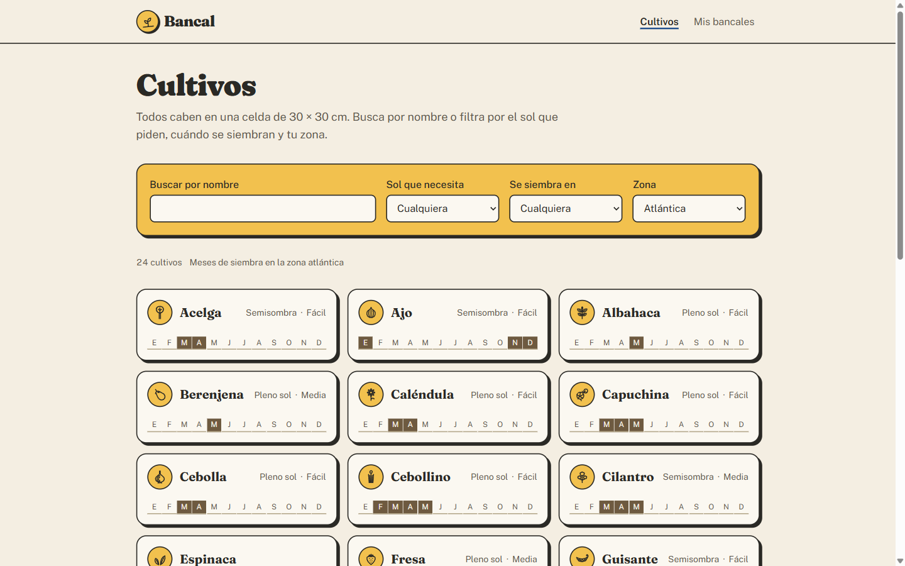
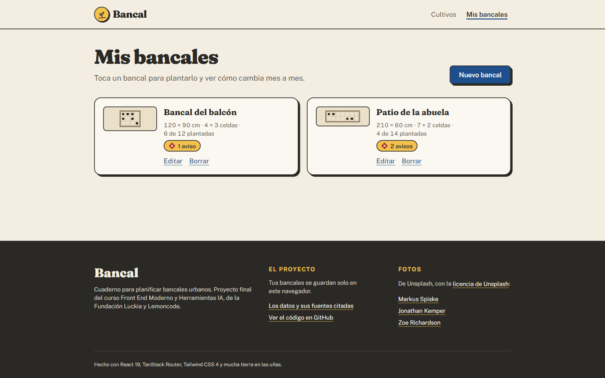
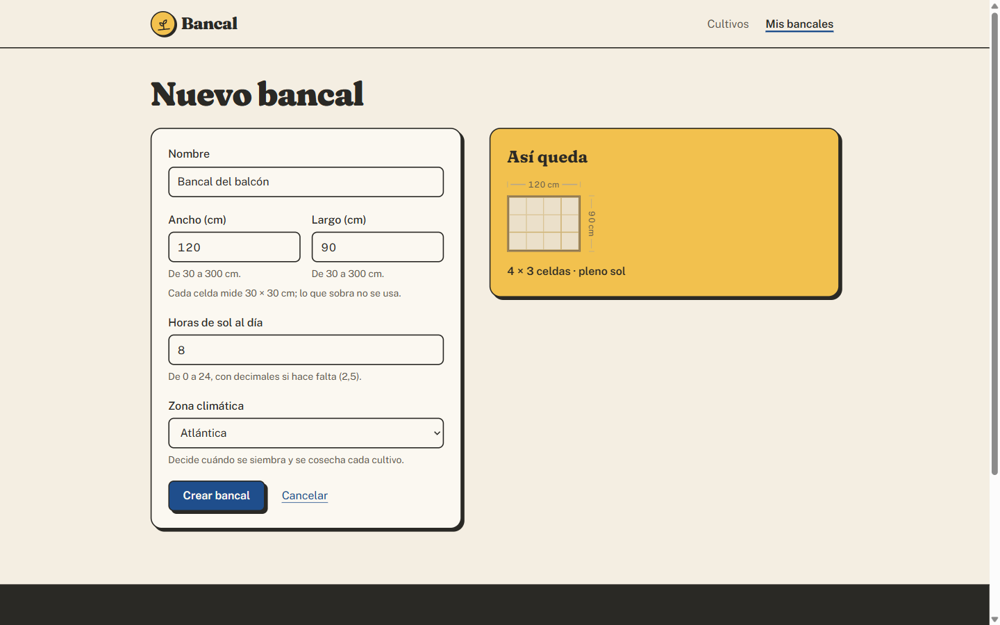
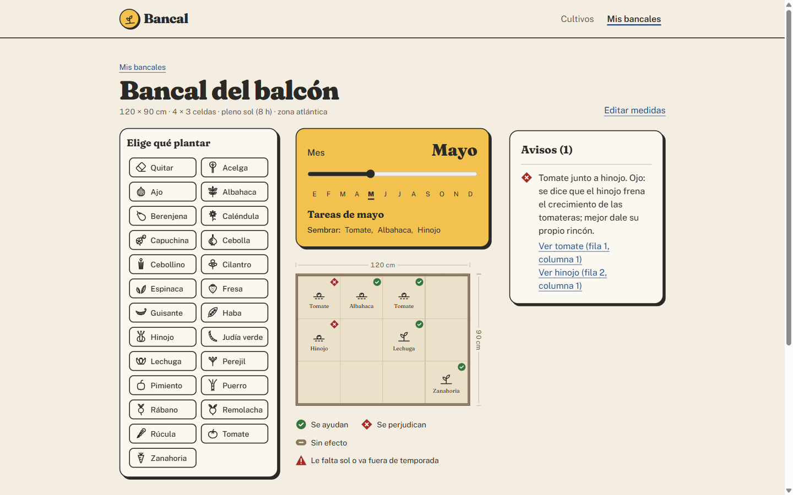
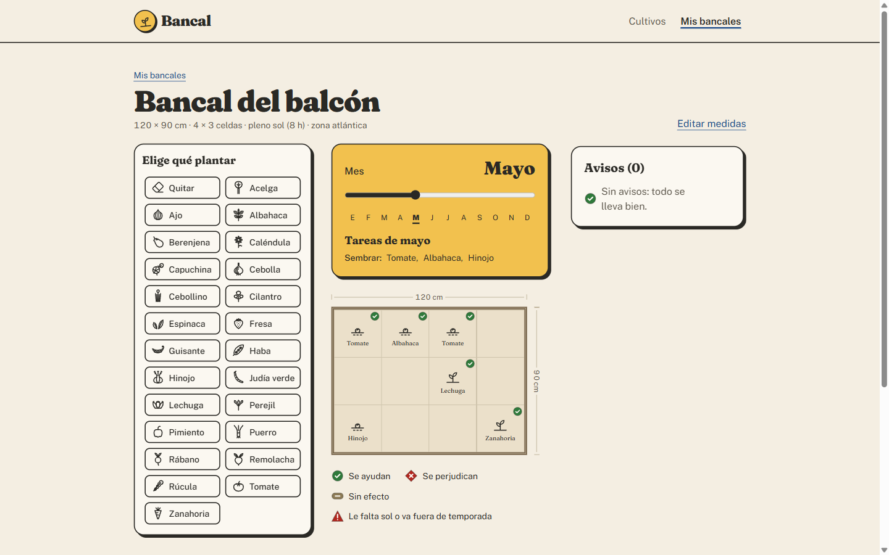
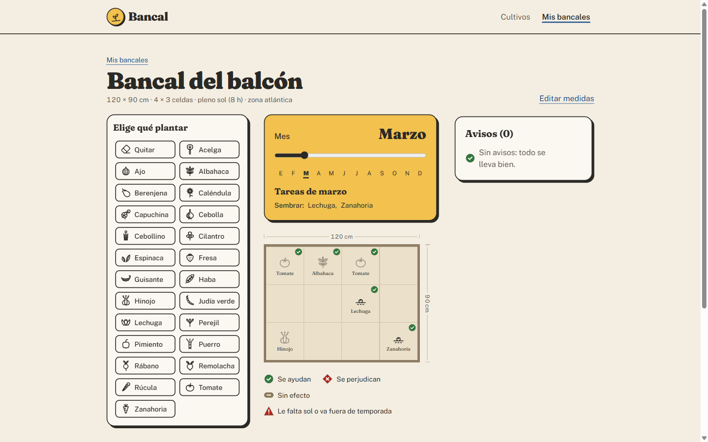
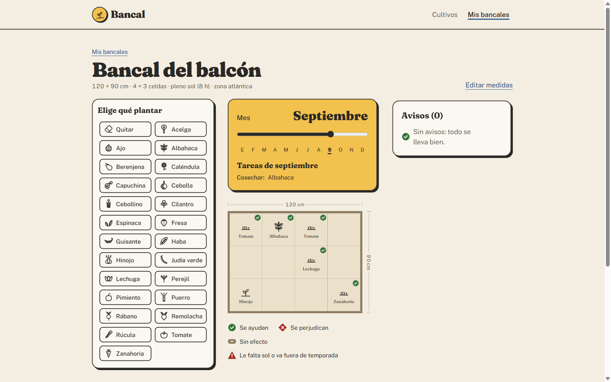
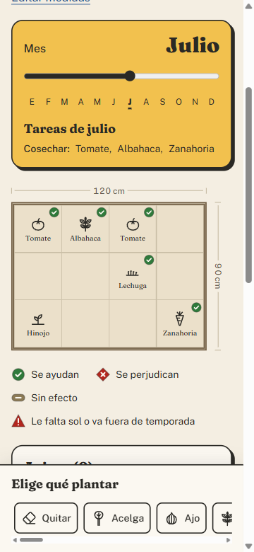
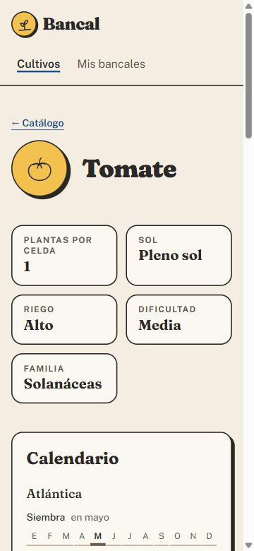

# Bancal

Planificador de huertos urbanos: dibuja tus bancales con sus medidas reales, coloca cultivos en una cuadrícula de 30 × 30 cm y descubre en vivo qué vecinos se ayudan, si hay sol suficiente y cómo evoluciona el huerto mes a mes.

Trabajo fin de curso de *Front End Moderno y Herramientas IA* (Fundación Luckia + Lemoncode). Individual y de frontend: el backend está simulado (un catálogo de 24 cultivos en `public/crops.json` y los bancales en `localStorage`, detrás de una capa `api` asíncrona), como permiten las bases.

Este README sigue el guion de presentación que proponen las bases del trabajo:

1. [La idea y el problema que resuelve](#1-la-idea-y-el-problema-que-resuelve)
2. [El MVP y las iteraciones completadas](#2-el-mvp-y-las-iteraciones-completadas)
3. [Demo](#3-demo): cómo ejecutarla, guion, capturas y rutas
4. [Tecnologías y herramientas de IA](#4-tecnologías-y-herramientas-de-ia), y cómo se han aplicado
5. [Retos y aprendizajes](#5-retos-y-aprendizajes)
6. [Próximos pasos](#6-próximos-pasos)

Al final, los créditos de las fotos y las fuentes de los datos de horticultura.

## 1. La idea y el problema que resuelve

Quien empieza un huerto en un balcón, una terraza o un patio tiene poco sitio y muchas dudas: cuántas plantas caben, cuáles se llevan mal (el hinojo frena a las tomateras), si las horas de sol de su rincón bastan y cuándo se siembra cada cosa en su clima. La información existe, pero repartida en calendarios regionales y tablas de asociación que no hablan entre sí.

**Bancal** lo junta en un cuaderno de campo:

- Dibujas el bancal **a escala**, con sus centímetros reales, y se divide en celdas de 30 × 30 cm (el método del huerto en cuadrados).
- Colocas cultivos con el ratón, el dedo o el teclado, y cada celda dice **al momento** si sus vecinos se ayudan, se perjudican o no se afectan, con el porqué en una línea.
- Avisa si a un cultivo le falta sol o si se siembra fuera de temporada en tu zona climática (atlántica, mediterránea o interior).
- Un deslizador de meses enseña el huerto **a lo largo del año**: sembrado, creciendo, en cosecha o terminado, y qué toca hacer cada mes.

Los avisos **aconsejan, nunca bloquean**: el huerto es tuyo.

## 2. El MVP y las iteraciones completadas

Antes de programar, el MVP se definió como un plan de tareas con criterios comprobables (`docs/tareas.md`). Cada tarea se construyó, se verificó y se cerró con su propio commit (`git log` cuenta la historia tarea a tarea), y lo que no entraba se apuntó como iteración.

### MVP (T1–T17)

| Fase | Tareas |
|---|---|
| Cimientos | T1 proyecto base (Vite, React, TypeScript, TanStack Router, Tailwind, Vitest) · T2 dirección visual y tokens de diseño |
| Dominio, con TDD | T3 modelo y esquemas Zod · T4 catálogo de 24 cultivos con fuentes citadas · T5 cuadrícula, vecindad y exposición al sol · T6 compatibilidad y avisos · T7 temporada (estado de cada planta y tareas del mes) · T8 capa `api` y hooks de datos |
| Pantallas | T9 catálogo con búsqueda y filtros en la URL · T10 ficha de cultivo · T11 Mis bancales · T12 alta y edición de bancal · T13 editor: cuadrícula y colocación · T14 editor: compatibilidades en vivo · T15 editor: temporada |
| Cierre | T16 repaso de responsive y accesibilidad · T17 README y demo |

### Iteraciones completadas

| Tarea | Qué aportó |
|---|---|
| T18 · Ciclo por zona | Al cerrar T7, los tests destaparon que en 16 combinaciones de cultivo y zona la primera cosecha caía fuera de la ventana de cosecha. Cada cultivo tiene ahora su ciclo en cada clima, contrastado con fuentes. |
| T19 · Iconos de cultivo | 24 dibujos SVG propios, a tinta, de lo que se cosecha (se reconocen a 24 px). |
| T20 · Portada y rediseño | Portada con fotos reales, «cómo funciona», un bento con lo que vigila la app y la tira de cultivos; pie común; y el estilo «cuaderno pop» (Fraunces muy gruesa, tarjetas y botones pegatina con sombra dura, amarillo girasol) llevado a todas las pantallas. |
| T21 · Navegación al instante | Caché en memoria con refresco por detrás, escritura directa de lo guardado y precarga al arrancar: cada pantalla aparece en menos de 100 ms. |
| T22 · Sin latencia simulada | Revisadas las bases, la espera artificial de la capa `api` no era un requisito: la app responde al momento y solo los tests simulan latencia. |
| T23 · Portada viva | Las notas de la foto de la portada enseñan, en cada visita, una pareja real del catálogo que se ayuda y otra que se perjudica. |
| T24 · Nota del mes | Un consejo genérico para cada mes, sin zona; los cultivos que nombra se siembran o se cosechan ese mes en las tres zonas (un test lo comprueba contra el catálogo). |

T18 y T19 se añadieron durante el MVP y se numeraron al final para no romper las referencias a las demás tareas. Cada tarea tiene en `docs/tareas.md` sus criterios y una línea **Verificación** con la evidencia con la que se cerró.

## 3. Demo

### Cómo ejecutarla

Requisitos: Node.js ≥ 22.12.

```bash
npm install
npm start          # servidor de desarrollo (Vite)
npm test           # tests (Vitest), una pasada: 448 tests
npm run build      # vite build + tsc --noEmit
npm run preview    # sirve el build
```

Un test concreto: `npx vitest run <ruta> -t "C14.4"` (los tests llevan el id del criterio de `docs/tareas.md`).

La app responde al instante: la capa `api` es un backend simulado sin espera artificial, que además precarga los datos al arrancar y los guarda en caché. Los estados de carga y de error están diseñados y cubiertos por los tests (que sí simulan latencia); para verlos a mano con una red lenta, usa el *throttling* de DevTools (pestaña Network, «Slow 4G»).

### Guion de la demo

1. **Portada**: la nota del mes (en noviembre, «Toca sembrar habas y guisantes») y dos parejas de vecinos que cambian en cada visita. «Crear mi primer bancal».
2. **Alta**: 120 × 90 cm, 8 h de sol, zona atlántica. La vista previa dice «4 × 3 celdas · pleno sol».
3. Al guardar se abre el **editor**. En la paleta, elige *Tomate* y coloca dos; elige *Albahaca* y ponla entre ellos: las celdas se marcan con ✓ (se ayudan).
4. Elige *Hinojo* y colócalo junto a un tomate: aparece el rombo ✕ en las dos celdas y el panel explica por qué y qué hacer. Nada impide colocarlo.
5. Mueve el hinojo a la otra punta (*Quitar* y volver a colocar): «Sin avisos: todo se lleva bien».
6. Arrastra el **deslizador de meses** de marzo a septiembre: el huerto pasa de *por sembrar* a semilla, brote, cosecha y rastrojo, y las «Tareas del mes» cambian.
7. Todo lo anterior se puede hacer solo con el teclado (Tab, flechas, Intro y Supr en la cuadrícula).

### Capturas

| | |
|---|---|
|  |  |
| Portada | Catálogo |
|  |  |
| Mis bancales | Alta de bancal |
|  |  |
| Editor: hinojo junto al tomate | Editor: sin avisos |
|  |  |
| Temporada: marzo | Temporada: septiembre |
|  |  |
| Editor a 360 px | Ficha de cultivo a 360 px |

### Mapa de rutas

| Ruta | Pantalla |
|---|---|
| `/` | Portada: qué es Bancal, cómo funciona, lo que vigila y los cultivos del catálogo |
| `/cultivos?q=&sol=&temporada=&zona=` | Catálogo: búsqueda y filtros en la URL (recargar o compartir conserva el resultado) |
| `/cultivos/$cultivoId` | Ficha de un cultivo: datos, calendario de las tres zonas y vecinos que ayudan o perjudican |
| `/bancales` | Mis bancales: croquis a escala, medidas, celdas plantadas y avisos; borrar con confirmación |
| `/bancales/nuevo` | Alta de bancal con vista previa a escala |
| `/bancales/$bancalId?mes=5` | Editor: cuadrícula, paleta, compatibilidades en vivo, avisos y temporada (el mes en la URL) |
| `/bancales/$bancalId/editar` | Edición de medidas (avisa de las plantaciones que se quitarían al encoger) |

## 4. Tecnologías y herramientas de IA

### Stack

El del curso, sin dependencias fuera de él:

| Herramienta | Para qué |
|---|---|
| React 19 + TypeScript 7 estricto | Componentes y tipos del dominio (uniones discriminadas para avisos y estados de la planta) |
| Vite 8 | Servidor de desarrollo y build |
| Tailwind CSS 4 | Tokens de diseño en `@theme`, *container queries* en el editor |
| TanStack Router | Rutas de fichero; filtros del catálogo y mes del editor en la URL, validados con Zod |
| TanStack Form + Zod 4 | Formulario de alta y edición, con mensajes en español |
| Vitest + Testing Library + jsdom | 448 tests: dominio con TDD, hooks, componentes y la app entera con su router |

No se usan React Router, TanStack Query, MSW ni librerías de animación: la caché de datos y las animaciones (CSS, siempre con `motion-safe:`) son propias.

### Arquitectura

```
src/
  routes/   solo navegación: leen params y search params y renderizan una escena
  scenes/   componen la pantalla y deciden la navegación
  pods/     portada/, catalogo/, bancales/, editor/ — contenedores (datos, estado) y componentes (props → render)
  core/     dominio puro con TDD: cuadrícula, vecindad, compatibilidad, avisos, estado de la planta,
            tareas del mes, esquemas Zod, la capa api y su caché
  common/   componentes compartidos (botón y tarjeta pegatina, alerta, iconos de cultivo, marcas de compatibilidad…)
  layouts/  cabecera, pie y foco al cambiar de pantalla
```

Lo derivado (avisos, estado de cada planta, tareas del mes, recuentos) se calcula en el render y nunca se guarda. Los datos pasan por una capa `api` asíncrona validada con Zod; sus hooks devuelven `{ data, loading, error }`, cancelan con `AbortController` y enseñan al momento lo ya leído mientras lo refrescan por detrás. Las reglas del dominio decididas durante el proyecto están en `CLAUDE.md` («Reglas del dominio»), y la dirección visual en `docs/brief.md`.

### Herramientas de IA y cómo se han aplicado

El proyecto se construyó con **Claude Code** como asistente de programación, trabajando tarea a tarea sobre `docs/tareas.md` con un *harness* propio (`.claude/`):

- **Skills** con las convenciones del proyecto: `tdd-core` (rojo → verde → refactor en `core/`), `react-bancal` (arquitectura y patrones de React), `react-testing`, `frontend-a11y`, `tailwind-clases-limpias`, `design-taste-frontend`, `brief-grill` (la entrevista que fijó la dirección visual de `docs/brief.md`), `plan-tasks` y `verify-task`.
- **Agentes** con ojos frescos y sin permiso de edición: `verificador` (tests, build, comprobación estática y navegador real con Playwright, criterio a criterio), `react-reviewer` (revisión de código), `design-reviewer` (revisión de diseño contra el brief) y `revisor-datos` (contraste de cada dato de horticultura con fuentes citadas).
- **Hooks**: no se crea un módulo de `core/` sin su test; no se puede parar con tests, build o comprobación estática en rojo ni con una tarea ✅ sin su línea de verificación; guardas contra acciones irreversibles; al empezar cada sesión se inyecta la tarea en curso.
- **MCP de Playwright**: la IA comprobó cada pantalla en un navegador real (a 360 y 1440 px, con teclado) e hizo las capturas de este README.
- **Cómo se usó**: la IA escribió el código y los tests siguiendo TDD; cada tarea del MVP pasó por el verificador y, en las pantallas, por las dos revisiones, y sus hallazgos se corrigieron antes de cerrar. Las decisiones de dominio, de alcance y de diseño las tomó el autor (EloSdev): por ejemplo, el ciclo por zona, qué pasa al encoger un bancal, pedir una portada más atrevida con fotos reales o quitar la latencia simulada. Quedaron escritas antes de que un test las fijara. Los datos de horticultura se contrastaron con las fuentes de abajo; la IA no inventa datos sin fuente.
- **Límites**: las iteraciones T20–T24 se cerraron con una comprobación más ligera (tests, build y capturas en el navegador), sin los agentes revisores, por el límite de uso. No se ha probado con un lector de pantalla real ni con toque en un móvil real (las comprobaciones de accesibilidad son por árbol de accesibilidad, teclado y Lighthouse).

## 5. Retos y aprendizajes

- **Los datos eran el mayor riesgo.** Las fuentes de horticultura no coinciden entre regiones, y algunas mezclan sembrar con trasplantar. Hubo que fijar qué significa «sembrar» en la app (cuándo entra la planta en el bancal), contrastar cada dato con un agente revisor y documentar lo que se deriva. Los tests destaparon que el ciclo tenía que ir por zona (T18). *Aprendizaje*: en una app de datos, los tests de coherencia del catálogo valen tanto como los de la interfaz.
- **Un editor accesible de verdad.** La cuadrícula se maneja con flechas (*roving tabindex*), cada celda dice en su nombre accesible qué tiene y cómo se lleva con sus vecinos, la compatibilidad nunca va solo por color (forma propia + icono + texto) y los cambios se anuncian resumidos con `aria-live`.
- **Que se vea moderno, no solo que funcione.** El MVP funcionaba pero se veía plano. El rediseño (T20) funcionó porque había un sistema: un único botón y una única tarjeta como componentes, y tokens en `@theme`. Cambiarlos llevó el estilo nuevo a toda la app de una vez. *Aprendizaje*: fijar al principio una dirección visual más ambiciosa, con referencias.
- **Rendimiento percibido.** La espera simulada de la `api` hacía que cada pantalla «tardara». Primero se compensó con caché y precarga (T21); después, al releer las bases, se vio que esa espera no era un requisito y se quitó (T22). *Aprendizaje*: contrastar los supuestos de la planificación con el enunciado.
- **Trabajar con IA.** Lo que mejor funcionó fue un plan con criterios comprobables, hooks que no dejan dar nada por terminado con los tests en rojo y una línea de verificación por tarea. La IA rinde cuando sabe exactamente qué es «hecho», y las decisiones de dominio se quedan del lado humano.

## 6. Próximos pasos

Lo que se añadiría con más tiempo, por prioridad:

1. **Dibujo de la planta de cada cultivo** y el trazo que se dibuja al cambiar de mes (`stroke-dashoffset`, el «detalle memorable» completo del brief). Ahora la temporada usa una semilla, un brote y un rastrojo compartidos y el icono del cultivo para la cosecha.
2. **Arrastrar y soltar** con vista previa de la compatibilidad antes de soltar.
3. **Deshacer y rehacer** en el editor.
4. **Resaltar en la cuadrícula la pareja de celdas** al pasar por un aviso del panel, y agrupar los avisos de un mismo cultivo («hinojo junto a 2 tomates»).
5. **Cultivos que ocupan varias celdas** (calabacín, calabaza, melón, alcachofa, tomate en jaula).
6. **Rotación por familia botánica** entre temporadas.
7. **Asistente «Mi primer huerto»** que propone un bancal de partida.
8. **View Transitions** entre pantallas.
9. **PWA sin conexión**, **compartir e imprimir** el bancal.
10. **Tests end-to-end** del guion de la demo (Playwright en CI).
11. **Registro de usuarios con su localidad**: con una cuenta, la nota del mes de la portada (hoy un consejo genérico, válido en todas las zonas) diría qué toca sembrar y cosechar en la zona climática de cada usuario, y sus bancales nacerían ya con esa zona.
12. Pulido pendiente anotado en las verificaciones: la paleta en dos columnas recorre con ↓ el botón siguiente y no el de debajo; la alerta de error de guardado desplaza la cuadrícula; en ~1024 px el panel de avisos cae fuera de la primera pantalla; el triángulo ▲ (sol y temporada) en un color propio para que no compita con «se perjudican»; vetas en las esquinas del marco y esqueleto de carga del editor; dividir el JavaScript (el build supera los 500 kB); el error de un campo aparece al teclear y no al salir del campo; ocultar el recuadro de foco del título cuando se navega con el ratón.

## Fotos de la portada

Fotos de [Unsplash](https://unsplash.com), con la [licencia de Unsplash](https://unsplash.com/license), servidas en webp a 800 y 1600 px desde `public/img/portada/`:

| Dónde | Autor | Foto |
|---|---|---|
| Cabecera | Markus Spiske | [Lechugas y cebollino en un bancal elevado](https://unsplash.com/photos/lettuce-and-chives-in-garden-bed-bk11wZwb9F4) |
| Paso 1 | Markus Spiske | [Brotes en una bandeja de semillero](https://unsplash.com/photos/selective-focus-photo-of-plant-spouts-vrbZVyX2k4I) |
| Paso 2 | Jonathan Kemper | [Plantando en un bancal elevado](https://unsplash.com/photos/person-planting-seedlings-in-raised-bed-VTXw4_5SsNA) |
| Paso 3 | Zoe Richardson | [Caja de cosecha con tomates y verduras](https://unsplash.com/photos/harvest-basket-with-tomatoes-and-vegetables-hmoDcZnB7uw) |
| «Mes a mes» | Markus Spiske | [Regando plantas jóvenes](https://unsplash.com/photos/person-watering-plant-sFydXGrt5OA) |

## Fuentes de los datos

Cada cultivo de `public/crops.json` cita en `fuentes` uno o varios de estos identificadores. Los datos se contrastaron con el agente `revisor-datos`; donde una fuente no distingue zonas climáticas o da un intervalo distinto, la adaptación se documenta en «Datos derivados».

| Id | Referencia | Qué respalda |
|---|---|---|
| `huerto-metro-cuadrado` | Huerto Metro Cuadrado, [«Guía visual de cultivo»](https://urbanisme.paeria.cat/sostenibilitat/fitxers/documents/a21e/recursos/2.huertometrocuadradoguiarapida.pdf) (2015, alojada por la Paeria de Lleida) | Plantas por celda de 30 × 30 cm |
| `sfg-phipps` | Phipps Conservatory, [«Square Foot Gardening»](https://www.phipps.conservatory.org/assets/documents/Square_Foot_Gardening_Guide_2020.pdf) (2020), método de Mel Bartholomew | Plantas por celda (contraste); albahaca y tomate en la misma fecha |
| `sfg-jerras` | Jerra's Garden, [«Plant Spacing – Square Foot Gardening»](https://www.jerrasgarden.com/blogs/gardening-info-growing-guides/plant-spacing-using-square-foot-gardening-as-a-plant-spacing-guide) (2022) | Plantas por celda de hinojo, rúcula, fresa, puerro, albahaca y tomate (a una guía) |
| `asturias-guerta` | Conceyu Llena y Conceyu Llaviana, Gobiernu del Principáu d'Asturies, [«Calandariu de la güerta n'Asturies»](https://www.lahuertinadetoni.es/wp-content/uploads/2020/08/Calendario-De-Siembra-Asturias.jpg) | Calendario de la zona atlántica (su leyenda junta «sembrar» y «trasplantar» en un mismo color) |
| `agapa-macetohuertos` | Agencia de Gestión Agraria y Pesquera de Andalucía (Junta de Andalucía), [«Calendario para macetohuertos»](https://www.juntadeandalucia.es/export/drupaljda/Calendario%20para%20macetohuertos.pdf) | Calendario de la zona mediterránea |
| `zaragoza-huertos-escolares` | Ayuntamiento de Zaragoza, Red de Huertos Escolares Agroecológicos, [«Los cultivos del huerto escolar»](https://www.zaragoza.es/cont/paginas/catalogopublicaciones/doc/12470.pdf) | Calendario de la zona interior; dificultad y cuidados |
| `huertina-toni` | Toni Jardón, [«Calendario de siembra»](https://www.lahuertinadetoni.es/calendario-de-siembra/), La Huertina de Toni | Calendario general (no por zonas; «depende del clima») para hinojo, cilantro, cebollino, albahaca, fresa, rábano y haba, y plazos de ajo (octubre → junio) y guisante (4–5 meses) en el ciclo por zona; y sus guías de [haba](https://www.lahuertinadetoni.es/guia-completa-del-cultivo-de-las-habas/), [rabanitos](https://www.lahuertinadetoni.es/como-cultivar-rabanitos-en-maceta-o-huerto-urbano-como-sembrar/), [albahaca](https://www.lahuertinadetoni.es/sembrar-germinar-la-albahaca-casa/) y [fresa](https://www.lahuertinadetoni.es/guia-completa-del-cultivo-de-las-fresas/) para su ciclo |
| `infoagro-cilantro` | Infoagro, [«El cultivo del cilantro»](https://www.infoagro.com/documentos/el_cultivo_del_cilantro.asp) | Ciclo del cilantro (40–60 días a la cosecha de hoja; unos 4 meses a la de semilla) |
| `infoagro-perejil` | Infoagro, [«El cultivo del perejil»](https://www.infoagro.com/aromaticas/perejil.htm) | Ciclo del perejil (tres meses desde la siembra) |
| `johnnyseeds-calendula` | Johnny's Selected Seeds, [ficha de caléndula «Ivory Princess»](https://www.johnnyseeds.com/flowers/calendula/ivory-princess-calendula-seed-4244.html) y [«Calendula – Key Growing Information»](https://www.johnnyseeds.com/calendula/calendula-key-growing-information.html) | Ciclo de la caléndula (días hasta la floración, floración hasta las heladas) |
| `cajamar-hinojo` | Cajamar, Centro de Experiencias de Paiporta, [boletín «El Huerto» n.º 162](https://www.cajamar.es/storage/documents/boletin-huerto-162-1496658756-7ba9e.pdf) | Hinojo en la zona mediterránea; sensibilidad a las heladas |
| `plantea-calendario` | Plantea en verde, calendarios de hortalizas y de aromáticas y flores comestibles, en [«Un huerto en tu terraza»](https://www.miteco.gob.es/es/ceneam/programas-de-educacion-ambiental/hogares-verdes/unhuertoentuterraza_tcm30-171915.pdf) (MITECO / CENEAM, Hogares Verdes) | Riego; calendario de caléndula y capuchina; siembra del ajo de octubre a febrero (no en agosto) |
| `zaragoza-calendario-escolar` | Ayuntamiento de Zaragoza, Concejalía de Medio Ambiente, «Calendario del huerto escolar», pág. 2 de [«Un huerto en tu terraza»](https://www.miteco.gob.es/es/ceneam/programas-de-educacion-ambiental/hogares-verdes/unhuertoentuterraza_tcm30-171915.pdf) (MITECO / CENEAM, Hogares Verdes) | Ciclo de interior del rábano (recogida a los 20–30 días) y de la fresa (6 meses desde la plantación) |
| `fundacion-vital` | Fundación Vital, [«Consejo 22: horticultura en balcones y terrazas»](https://www.fundacionvital.eus/sites/default/files/Documentos/Consejo_22.pdf) | Necesidad de sol por tipo de cultivo |
| `uw-hortlib` | University of Washington, Elisabeth C. Miller Library, [«Vegetables that can tolerate partial shade»](https://depts.washington.edu/hortlib/pal/vegetables-that-can-tolerate-partial-shade/) | Cultivos que toleran semisombra |
| `planetahuerto-asociaciones` | Rosendo Elvira (Planeta Huerto), [tabla de asociación de cultivos y necesidades de espacio](https://botanicoalcala.web.uah.es/wp-content/uploads/planeta-huerto-asociación-decultivos-y-necesidades-de-espacio.pdf) (2019, Real Jardín Botánico de la Universidad de Alcalá) | Asociaciones favorables y desfavorables |
| `wsu-snaped` | Washington State University SNAP-Ed y Food Hero, [«Asociación de cultivos»](https://wpcdn.web.wsu.edu/wp-snaped/uploads/sites/3/2022/04/Companion_Planting_WSU_SP.pdf) | Tomate con albahaca, zanahoria y lechuga |
| `uf-ifas-companion` | UF/IFAS Extension, Manatee County, [«Vegetable Companion Planting Chart»](https://mail.growables.org/informationVeg/documents/CompanionGuideUF.pdf) (copia en growables.org) | Segunda fuente de tomate–albahaca (favorable) y tomate–hinojo (desfavorable) |
| `portalfruticola-tomate` | Portal Frutícola, [«15 de las mejores plantas que puedes cultivar junto con los tomates»](https://www.portalfruticola.com/noticias/2023/11/29/15-de-las-mejores-plantas-que-puedes-cultivar-junto-con-los-tomates) (2023) | Tomate con hinojo y berenjena (desfavorables) y con perejil, ajo y cebolla (favorables) |
| `portalfruticola-rucula` | Portal Frutícola, [«10 tips esenciales en el cultivo de rúcula»](https://www.portalfruticola.com/?p=618759) | Calendario y sol de la rúcula |

### Datos derivados

Lo que no sale literalmente de una fuente:

- **Una ventana por zona.** Si una fuente da dos ventanas de siembra separadas por dos meses o menos, se unen; si no, se queda la más larga. **Excepción:** no se unen cuando el hueco es justo la época que la fuente excluye (calor en verano) o cuando el resultado pondría la planta «en cosecha» mucho más tiempo que su ciclo; entonces se queda un solo ciclo (zanahoria, lechuga y cebolla en interior).
- **Cultivos de calor en la zona atlántica.** El calendario de Asturias marca marzo con el color que junta «sembrar» y «trasplantar». Como Andalucía (AGAPA) no trasplanta el tomate antes de la segunda quincena de abril y Zaragoza pide para la berenjena «que haya pasado el frío», en la zona atlántica tomate, berenjena y albahaca entran al bancal en mayo y la judía verde en abril–mayo (necesita más de 15 °C).
- **Espinaca en la zona atlántica**: Asturias da solo abril (siembra) y junio (cosecha); se amplía a marzo–abril y mayo–junio con Zaragoza (trasplante en marzo–abril, cosecha a los 50–80 días), porque una ventana de un mes avisaría «fuera de temporada» sin motivo.
- **Tomate a una planta por celda**: con poda a una sola guía y entutorado (Zaragoza; Jerra's da 1 por celda así). En jaula ocuparía 2 × 2 celdas (Phipps, Jerra's), algo que el MVP no contempla.
- **Hinojo a una planta por celda**: Cajamar da unas 10 plantas/m² en cultivo comercial en Valencia (0,9 por celda de 0,09 m²); se prefiere a las 4 del método de cuadrados.
- **Cosecha en interior.** La fuente de Zaragoza da días hasta la cosecha: el inicio es el de la siembra más los días mínimos, redondeado al mes.
- **Zonas sin fuente propia.** Perejil, cilantro, cebollino, caléndula y capuchina usan el mismo calendario en las tres zonas; la albahaca se siembra con el tomate de cada zona. Haba, rábano y fresa no están en el calendario de Asturias: su ventana atlántica sale del calendario general de La Huertina de Toni.
- **Riego, dificultad, sol y familia** de algunos cultivos son criterio propio cuando ninguna fuente los da, y la familia botánica sigue la taxonomía habitual. Criterio propio, en concreto: el sol de hinojo, caléndula, capuchina, fresa, cebolla y haba (pleno sol); el riego de hinojo, haba, puerro, cilantro y rúcula; la dificultad de los cultivos que no trata la fuente de Zaragoza.
- **Ciclo** (meses hasta la primera cosecha y meses de cosecha, contados desde que la planta entra en el bancal). Hasta la cosecha: el punto medio de los días que da la fuente, entre 30 y redondeado (mínimo 1), con Zaragoza como primera opción salvo que otras dos fuentes coincidan en otro plazo (rábano: un mes, según la guía y el calendario de La Huertina de Toni); el hinojo cuenta los 3–5 meses de Cajamar desde la plantación, no los 5 desde la siembra; si ninguna fuente da días, la distancia entre el inicio de la siembra y el de la cosecha en el calendario de la zona mediterránea (guisante, ajo, cebollino, capuchina). Meses de cosecha: la duración que dé la fuente; 1 si se cosecha de una vez; si se cosecha a lo largo del tiempo, la ventana de cosecha menos la de siembra más uno, recortada para no cosechar en invierno (berenjena y pimiento hasta octubre, capuchina hasta noviembre, según Plantea); la judía verde de mata baja, 2. Fresa, perejil, cebollino, caléndula y capuchina son perennes o bianuales: su ciclo representa **una temporada** en el bancal. **Desde T18 el ciclo va por zona**, porque en cada clima se crece a otro ritmo (lo que pasa el invierno va más despacio): en cada zona se parte del valor anterior y, si la primera cosecha (sembrando el primer mes de la ventana) caía fuera de la ventana de cosecha de la zona, se cambian los meses hasta la cosecha para que caiga dentro. Los 16 pares cambiados se contrastaron con fuentes (zanahoria mediterránea, hinojo atlántico e interior, lechuga atlántica, rábano de interior, espinaca mediterránea, remolacha atlántica y mediterránea, guisante y haba de interior, haba atlántica, cebolla atlántica, ajo atlántico y de interior, fresa mediterránea y de interior). Con esa revisión cambiaron además algunas ventanas: el ajo de interior se siembra de octubre a enero (lo de agosto en la barra de Zaragoza son ajetes, no cabezas), la haba atlántica de octubre a febrero, el guisante de interior en octubre y noviembre, la fresa de interior se planta hasta marzo, la fresa atlántica se cosecha de junio a octubre y el rábano de interior de abril a junio.
- **Correcciones de calendario con las guías de cultivo**: el cilantro se cosecha de mayo a julio (Infoagro: hoja a los 40–60 días; la cosecha de agosto del calendario general era la de semilla). El rábano atlántico se siembra de febrero a noviembre: la guía de La Huertina de Toni dice que se siembra «casi todo el año, evitando las épocas más duras del invierno», y que en veranos muy calurosos se eviten esos meses (los veranos atlánticos son suaves); su calendario mensual, en cambio, marca enero–marzo y agosto–diciembre.
- **Asociaciones**: son conocimiento tradicional de huerta, no resultados de ensayos (lo advierte la propia guía de WSU). Las parejas de la demo (tomate–albahaca, tomate–hinojo) tienen al menos dos fuentes independientes; el resto sale **de una sola fuente**, la tabla de Planeta Huerto, cuando la recoge en las fichas de los dos cultivos. Los motivos lo dicen con prudencia.
- **Celda.** El método de cuadrados usa un pie (30,48 cm); se trata como la celda de 30 cm.
